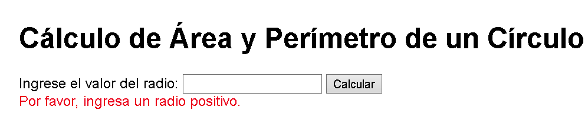
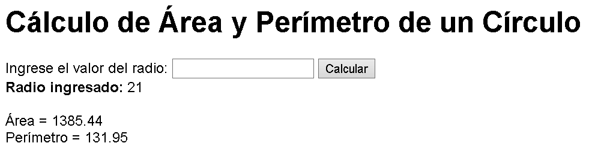
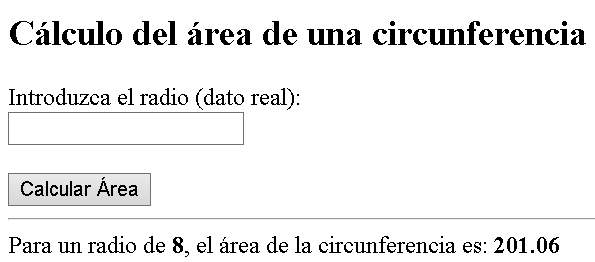
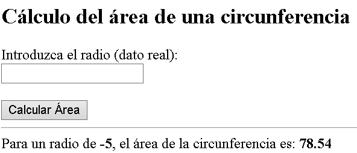
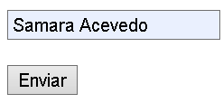
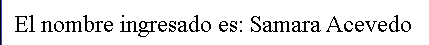

# 🧺 Primeros pasos y ejemplos en PHP

Este repositorio reúne diversos casos prácticos desarrollados en PHP, pensados para comprender y afianzar los fundamentos del lenguaje:

- Declaración de variables y conversión de tipos (casting)
- Estructuras condicionales (`if / else`) y manejo de fechas
- Interacción con formularios HTML y gestión de solicitudes HTTP (GET y POST)
- Operaciones aritméticas y lógica de calculadora usando funciones como `round`
- Integración de código PHP dentro de estructuras HTML

---

## 🌐 Tecnologías y versiones


| Tecnología | Versión | Uso |
| --- | --- | --- |
| PHP | _( 8.3.28x)_ | Lenguaje de los ejemplos |
| Apache | _(2.4.65x)_ | Servidor web local |
| WampServer | _(3.4.0x)_ | Entorno local (Apache + PHP) |
| Visual Studio Code | _(1.140.00)_ | Editor de código |

> 💡 Para saber la versión de PHP, ejecuta `Practica_info.php` en el navegador (`phpinfo()`) o `php -v` en la terminal.

---

## 📁 Detalles del laboratorio

Cada archivo es un ejercicio independiente que se ejecuta desde el navegador.

| Archivo | Descripción |
| --- | --- |
| `Practica_Iniciacion.php` | Primeros pasos: sintaxis básica de PHP y salida de texto |
| `Practica_Variables.php` | Declaración de variables y conversión de tipos (casting) |
| `Practica_info.php` | Información de la configuración de PHP del servidor |
| `Practica_Endebido.php` | Práctica de integración de PHP dentro de HTML |
| `Ejemplo3.php`, `Ejemplo7.php`, `Ejemplo8.php` | Ejemplos de clase: condicionales, fechas y formularios (GET / POST) |
| `Laboratorio_Area,Perimetro.php` | Formulario que calcula el área y el perímetro de un círculo, con validación de radio positivo |
| `Laboratorio_Area_de_la_Circunferencia.php` | Formulario que calcula el área de una circunferencia a partir del radio |
| `Laboratorio_Calculadora.php` | Calculadora con operaciones aritméticas y `round` |
| `Laboratorio_Converción_cm_a_plg.php` | Conversión de centímetros a pulgadas |
| `Problemas_Matematicos.php` | Resolución de problemas matemáticos con PHP |

---

## 🎛️ Controles utilizados

| Control | Uso en el laboratorio |
| --- | --- |
| Formulario (`<form>`, método `POST`) | Envía los datos ingresados al mismo script PHP |
| Campo de entrada (`<input>`) | Ingreso del radio, del nombre y de otros valores |
| Botón de envío | "Calcular", "Calcular Área" y "Enviar" |
| Etiquetas de texto | Indican qué dato debe ingresar el usuario |
| Mensajes de validación (PHP) | Avisan cuando el dato no es válido (ej. radio no positivo) |

---

## 🖼️ Evidencia de ejecución

### ➕ Insertar registros (ingreso de datos)

Estos ejercicios no usan base de datos: el "registro" es el dato que el usuario escribe en el formulario y que PHP procesa.

**Cálculo de Área y Perímetro de un Círculo** (`Laboratorio_Area,Perimetro.php`)

Validación cuando no se ingresa un radio positivo:



Resultado con radio 21:



**Cálculo del área de una circunferencia** (`Laboratorio_Area_de_la_Circunferencia.php`)

Resultado con radio 8:



Prueba con radio negativo (-5). Este ejercicio no valida el signo del radio, por lo que calcula el área igualmente:



**Formulario de nombre (método POST)**

Ingreso del nombre:



Resultado mostrado tras enviar:



### ✏️ Modificar

No aplica en este laboratorio: los ejercicios no almacenan datos, por lo que no hay registros que modificar.

### 🗑️ Eliminar

No aplica en este laboratorio: los ejercicios no almacenan datos, por lo que no hay registros que eliminar.

---

## ⚙️ Procesos de instalación

### Requisitos previos

Un entorno local con soporte para PHP. Se recomienda un paquete integrado que incluya servidor web y PHP, como **WampServer** (Windows) o **XAMPP**.

📌 Estas herramientas son entornos simulados en tu equipo y no deben confundirse con servidores de producción.

### Pasos

1. Instala WampServer (o XAMPP) e inicia Apache.
2. Clona el repositorio dentro de la carpeta `www` (WampServer) o `htdocs` (XAMPP):

   ```bash
   git clone https://github.com/elizaacevedo1024-star/EjemplosBasicosPHP.git
   ```

3. Abre en el navegador la carpeta del proyecto:

   `http://localhost/EjemplosBasicosPHP/`

4. Selecciona el archivo `.php` que quieras ejecutar, por ejemplo:

   `http://localhost/EjemplosBasicosPHP/Laboratorio_Calculadora.php`

---

## 👨‍💻 Autora y fecha

**Elizabeth Acevedo**
Estudiante de licenciatura en Ciberseguridad
Universidad Tecnológica de Panamá

- 📧 **Email:** elizabeth.acevedo@utp.ac.pa
- 🌐 **GitHub:** https://github.com/elizaacevedo1024-star
- 📅 **Fecha de creación:** 21-08-2026
- 🔄 **Última actualización:** 07-10-2026


---

## 📚 Referencias

- Manual de PHP: https://www.php.net/manual/es/
- Formularios HTML (MDN): https://developer.mozilla.org/es/docs/Web/HTML/Element/form
- WampServer: https://www.wampserver.com/en/
- Visual Studio Code, documentación: https://code.visualstudio.com/docs
